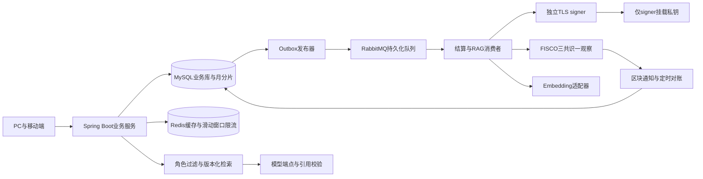
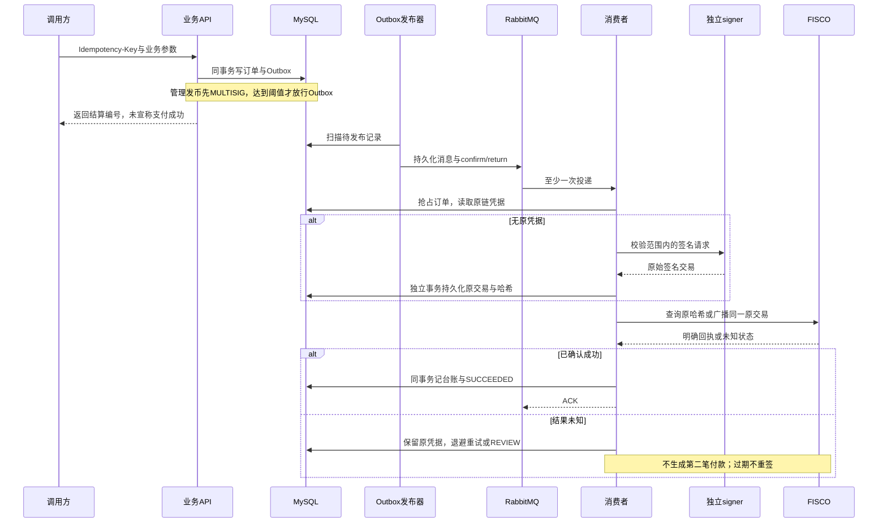

# 基于区块链的时间币服务系统

Java 后端项目，主线是**异步结算可靠性**：以 Outbox + 幂等 + 独立签名 + 链上对账处理跨系统结果不确定性；在此之上实现 **RAG 知识库问答 + 三个受限业务 Agent**、**按月分表**与**业务级联盟链治理**。

**技术栈**：JDK 21、Spring Boot 4.0.9、Spring Framework 7.0.10、MyBatis starter 4.0.0、ShardingSphere-JDBC 5.5.2、AgentScope Java 2.0.5、OkHttp 5.3.2、Redis、RabbitMQ、MySQL 8、Vue 2、Hardhat / Solidity、FISCO BCOS 3.8。enforcer 强制 JDK 21，低版本无法编译。

> 说明：本文只描述**当前状态**。历史版本的改造记录、测试日志名与提交号不再保留；压测数据为升级前环境实测，见第八节口径说明。

---

## 一、项目结构

| 目录 | 说明 |
|------|------|
| `backend/timecoin-web` | Spring Boot 后端 API，默认端口 **8080** |
| `vue-system/pc` | PC 管理端，默认端口 **7000** |
| `vue-system/phone` | 移动端 H5（老人 / 志愿者），默认端口 **7001** |
| `TimeCoinSystem/` | Hardhat + Solidity 合约 |
| `k8s/base`、`k8s/fisco` | K3S 部署清单（业务 + 中间件 / 联盟链节点与 signer） |
| `performance/` | 压测场景与结果 |
| `tools/apache-maven-3.9.6/` | 捆绑 Maven |

启动顺序：先后端，再启动 PC 或移动端（可同时开）。

---

## 二、环境要求

| 组件 | 说明 |
|------|------|
| JDK | **21**（编译、测试、后端与 signer 镜像统一；enforcer 限制 `[21,22)`） |
| Node.js | 16+ / 18+（前端与 Hardhat） |
| MySQL | 默认使用 MySQL；本地无 MySQL 时显式启用 `dev` profile 使用 H2 文件库并关闭链 |
| Maven | 项目自带 `tools/apache-maven-3.9.6/`；若该副本缺少 `boot/` 依赖，改用本地 Maven 3.9+ |

---

## 三、快速启动

### 1. 后端（必须先做）

启动前**必须设置 `JWT_SECRET`**（至少 32 字节，可用 `[Convert]::ToBase64String([RandomNumberGenerator]::GetBytes(32))` 生成）；未配置则启动失败。首次构建从根目录安装本项目模块依赖：

```powershell
mvn -f backend/pom.xml install -DskipTests
```

本地快速体验（H2 文件库、关闭链与 MQ，不发付费答谢）：

```powershell
cd backend\timecoin-web
..\..\tools\apache-maven-3.9.6\bin\mvn.cmd spring-boot:run '-Dspring-boot.run.profiles=dev'
```

使用 MySQL + 中间件（默认配置）：确保 MySQL 运行、设置 `DB_PASSWORD` 后直接 `mvn spring-boot:run`；首次启动自动执行 `schema-*.sql` 初始化，含演示管理员 `admin/123456`（对外使用前必须改口令）。

成功标志：日志出现 `Tomcat started on port(s): 8080` 与 `Started TimecoinWebApplication`。API 根地址：**http://localhost:8080**，停止用 `Ctrl+C`。

### 2. PC 管理端

```powershell
cd vue-system\pc
npm install
npm run serve
```

浏览器打开 **http://localhost:7000**；请求后端地址在 `src/utils/request.js`，默认 `http://localhost:8080`。用于管理员登录与后台管理（公开注册已关闭，由现有管理员创建账号）。

### 3. 移动端（老人 / 志愿者 H5）

```powershell
cd vue-system\phone
npm install
npm run serve
```

本机访问终端提示地址（常见 **http://localhost:7001/**）。真机访问需把 `src/utils/request.js` 的 `baseURL` 从 `localhost` 改为电脑局域网 IP（如 `http://192.168.1.100:8080`），否则手机会连自己。

### 4. 区块链合约（可选）

`dev` 模式可不启动链；付费答谢、转账、发币需连接真实节点。默认链配置指向本机 Hardhat：

```powershell
cd TimeCoinSystem
npm install
npx hardhat node
```

另开终端部署：

```powershell
cd TimeCoinSystem
npx hardhat deploy --network localhost
```

部署后需把 `blockchain.contract-address` 更新为新地址。FISCO 联盟链方式见 `deploy/fisco/` 与 `k8s/fisco/`。

---

## 四、登录与角色

| 端 | 角色 | 说明 |
|----|------|------|
| PC | 管理员 | 登录后操作后台；演示账号 `admin/123456`，新账号由管理员创建 |
| 移动端 H5 | 老人、志愿者 | 注册时选择类型，账号密码登录 |

登录接口为根路径 `POST /login`，body 含 `username/password/role`（管理员 `role=3`）；**token 放在 `token` 请求头**，不是 `Authorization`。

---

## 五、关键配置

配置项集中在 `backend/timecoin-web/src/main/resources/application.properties`，敏感值走环境变量：

| 环境变量 | 用途 |
|----------|------|
| `JWT_SECRET` | JWT 签名密钥，至少 32 字节，必填 |
| `DB_PASSWORD` | MySQL 密码 |
| `REDIS_HOST/PORT/PASSWORD`、`RABBITMQ_HOST/PORT/USER/PASSWORD` | 中间件连接 |
| `BLOCKCHAIN_ENABLED`、`BLOCKCHAIN_RPC_URL`、`BLOCKCHAIN_CONTRACT_ADDRESS`、`BLOCKCHAIN_PRIVATE_KEY` | 链开关与连接（默认本机 Hardhat + 演示私钥，生产必须替换） |
| `AI_CHAT_ENABLED`、`AI_CHAT_BASE_URL`、`AI_CHAT_API_URL`、`AI_CHAT_API_KEY`、`AI_CHAT_MODEL` | 大模型端点（OpenAI 兼容，**须支持原生 tool_calls**）；默认 key 为空，不配置则 Agent/RAG 不调用远程模型 |
| `AI_RAG_EMBEDDING_MODE/URL/KEY/MODEL/DIMENSIONS`、`AI_RAG_ANSWER_MODE` | RAG：`remote`/`local-hash` 与 `model`/`extractive` |
| `AI_RAG_MQ_ENABLED` | 默认跟随 `settlement.mq-enabled`；关闭时文档导入保持 `PENDING` |
| `AGENT_MYSQL_PASSWORD` | Agent 专用 MySQL 集成测试 |

Agent 预算：`agent.react.max-iterations=6`、`max-tool-calls=12`、`timeout-seconds=90`（单次模型 35s 不重试；仍为 4 工作线程 + 16 排队）。默认 `dev` 使用 `local-hash/extractive` 离线模式，不自动降级到真实模型。

---

## 六、系统架构

业务 API、Outbox 与消费者在同一 Spring Boot 应用内，signer 独立部署；没有拆成微服务。



### 结算时序



### AI 能力

- **RAG**：文档与 Outbox 同事务入库 → RabbitMQ 异步切分(600 码点)/Embedding → 按角色过滤 + 版本化内存向量 Top-5 → 引用溯源（引文须来自本次检索且为原文连续片段，否则拒答）。异步任务 180s 租约抢占，失败 5 次转 `REVIEW`。
- **三个受限 Agent**（AgentScope `ReActAgent` 循环，原生 `tool_calls`，每轮观察工具结果）：

| Agent | 工具与最终行为 |
|-------|----------------|
| 发布 | `validate_draft` 返回字段问题供模型修订；`complete` 返回已校验草稿。发布与扣费仍须独立的用户确认接口。 |
| 审核 | `inspect_activity` 只查当前批次选中活动；固定规则风险不能被模型降级；结果均待人工审批。 |
| 运营 | `activity_registration_top` / `coin_daily_flow` 执行固定参数化 SQL；数值与图表由服务端结果构造，模型不能提交 SQL 或编造指标。 |

  模型只做只读工具选择；写操作在循环外由人工确认触发。每次请求独立上下文、服务端注入身份并逐步复验；`agent_audit` 只记摘要哈希，不存思维过程/原文/密钥。

### 可观测性与评测

- **Agent 遥测**：复用 `agent_audit`，以 ReAct `runId` 作为 `traceId` 串联一次流程；Hook 记录 `MODEL_CALL`（模型、轮次、耗时、供应商 token 用量，缺失标记 `usageReported=false`）、`TOOL_CALL`（成功/失败/取消/未注册）与 `REACT_COMPLETE/REACT_FAILED` 汇总。日志不记原始问题、提示词、思维过程或密钥；属应用级追踪，未接入 OpenTelemetry。
- **RAG 评测集**：`evaluation-v1.json` 24 条标注（16 可回答 / 8 无依据，含角色隔离与领域外问题），离线跑真实入库/检索/回答；local-hash 基线引用命中 14/16、无依据召回 8/8。指标只校验引用与拒答决策，**不是**生成质量或真实语义检索准确率。

### 关键设计取舍

| 问题 | 当前实现与取舍 |
|------|----------------|
| 为什么不能只用分布式锁防重复付款？ | 锁只控制一段时间内谁执行，租约失效后仍可重做。幂等键按业务主体限定、同键参数变化拒绝；订单、原交易凭据和台账复用跨重试结果。 |
| Outbox 为什么可靠？ | 业务变更与 Outbox 同事务；confirm/return + 轮询补偿处理投递不确定性。消息可能重复，消费者仍需幂等，不是端到端 exactly-once。 |
| nonce 为什么用数据库行锁？ | 以太坊递增 nonce 需跨实例分配；短事务行锁分配并先持久化。FISCO 用随机 nonce，不沿用递增表。 |
| 版本缓存解决了什么？ | 公告修改与版本递增同事务，缓存键带版本，旧读回填不覆盖新版本；TTL 抖动、短空值缓存、互斥重建分别处理集中到期、空结果与击穿。 |
| 分表为何选月份？ | 结算有时间查询与保留周期，便于裁剪路由与预建表。当前是单 MySQL 按月分表，不是多库水平扩容。 |
| 三共识一观察能容忍恶意节点吗？ | 不能。PBFT 的 `3f+1` 只计共识节点；四共识才满足 f=1。当前拓扑仅用于职责分离演示。 |
| signer 与多签分别保护什么？ | signer 把交易私钥隔离出业务进程并校验链/群组/合约/selector；多签要求管理操作由不同审批人批准。signer 不是 HSM。 |
| RAG 引用校验消除幻觉吗？ | 只验证引用来自检索证据且引文存在，不证明每句推论正确；真实模型质量仍待单独评测。 |

---

## 七、主要 API

| 分类 | 接口 | 说明 |
|------|------|------|
| 认证 | `POST /login` | 登录，token 走 `token` 头 |
| 知识库 | `GET/POST /administrator/knowledge`、`DELETE /{id}`、`POST /{id}/retry` | 导入(需 Idempotency-Key)、禁用、重试 |
| RAG 问答 | `POST /users/old/ai/chat`、`/users/vol/ai/chat` | body `{"message":"问题"}` |
| Agent-发布 | `POST /users/old/agent/publish`(需 Idempotency-Key)、`GET /{id}`、`POST /{id}/confirm` | 草稿校验 → 收集 → 用户确认 |
| Agent-审核 | `GET /administrator/agent/reviews/candidates`、`POST /administrator/agent/reviews`(需 Idempotency-Key)、`POST /{id}/decision` | 批量预筛 → 人工决定 |
| Agent-运营 | `POST /administrator/agent/analytics` | body `{"question":"..."}` |
| 链管理 | `GET /administrator/chain/status\|balance\|settlements\|transactions\|governance`、`POST /chain/mint\|transfer\|settlements/{id}/retry\|transactions/{txHash}/resume` | 均需管理员 token |

所有写请求携带 `Idempotency-Key`（8–100 位字母/数字/`:`/`_`/`-`）；客户端超时必须复用原键。

---

## 八、性能数据（口径）

`GET /dashboard/notices?limit=10` 的小数据公告缓存读取压测（16 线程、60 秒测量）：

| 指标 | 实测值 |
|------|--------|
| 样本数 / 错误数 | 257414 / 30 |
| 吞吐 | 4296.97 请求/秒 |
| 平均 / P95 / P99 | 3.48ms / 7ms / 11ms |
| 错误率 | 0.011654%（30 次均为 503） |
| 首次查询缓存命中率 | 99.987569% |

**口径限制**：这是升级前 Java 11 / Boot 2.6 环境下的数据，不代表当前 Boot 4 版本性能；仅适用于小数据公告缓存读取，不能外推为结算 TPS、链吞吐、模型 QPS 或生产 SLA。缓存重建时当前策略明确拒绝并发读（产生 503），无"优化前"对照组，不声称提升倍数。场景文件 `performance/notices.jmx`，原始采样 `performance/results/`。

---

## 九、已知边界（诚实声明）

- **分表非分库**：单物理数据源按月分表，未实现多库分片 / XA；`user/activity` 广播表配置在单源下仍各只有一份。
- **向量库为内存实现**：无 ANN、pgvector 或 Milvus 适配，适用于小规模知识库。
- **模型效果未做生成质量评测**：已有 24 条标注的离线 RAG 评测集，只校验引用与拒答决策；未接真实付费供应商做生成质量 / 语义检索评测，默认模型名不构成 tool_calls 能力保证。
- **Agent 是受限工作流**：不是自治 Agent、多 Agent 协作或通用 Agent 平台；写操作不让模型直接执行。
- **signer 不是 HSM**：宿主机管理员仍可读取密钥；不等同硬件隔离或合规背书。
- **无运营合规背书**：无第三方合约审计、等保或备案；时间币为封闭记账积分，不提现/兑换/投资。`userId` 属可关联标识而非匿名化数据。
- **发布边界**：git 历史仍含脱敏前 PDF/报告，转 public 前需先重写历史并复核。

---

## 十、常见问题

**端口 8080 被占用**

```powershell
netstat -ano | findstr :8080
taskkill /PID <PID> /F
```

修改后端端口需同步改各前端 `request.js` 的 `baseURL`。

**注册/登录失败或数据库连接错误**：`dev` 需确认显式启用 profile；MySQL 需确认账号密码与库表初始化。

**移动端能开页面但接口失败**：真机 `baseURL` 必须用电脑局域网 IP + 8080，不能用 `localhost`。

**提示"限流服务暂不可用" / MQ 连接失败**：检查 Redis(6379) 与 RabbitMQ(5672) 是否运行；限流为 fail-closed，Redis 不可用会直接拒绝请求。

**链上交易未确认、余额不变**：若重启过 Hardhat，旧链的 `chain_submission` 记录会把 nonce 顶高导致 `Nonce too high`、交易无法广播。处理方式是备份后清理链结算相关表（见 `.workbuddy/memory/2026-11-20.md`）再重新提交。

---

## 十一、求职表述口径

定位：Java 后端研发，以异步结算可靠性为主线，RAG 工程与联盟链治理为补充。以下表述须能亲自解释实现与验证过程，不能把 AI 辅助开发描述为个人独立完成全部架构。

- 围绕时间币异步结算，实现业务幂等、事务 Outbox、RabbitMQ 确认与重复消费处理；链交易先持久化再广播，结合原哈希恢复和对账处理跨系统结果不确定性。
- 使用 Redis 实现 Lua 滑动窗口限流和版本化公告缓存；基于 ShardingSphere-JDBC 实现结算相关表按月分片，覆盖跨月定位与恢复测试。
- 实现知识库异步入库、分块 Embedding、按角色过滤检索及引用校验，并用 24 条标注评测集校验引用与拒答决策；补充三个受限业务 Agent（活动草稿与用户确认、批量风险预筛与人工审批、白名单数据查询与可核对图表），通过幂等、版本校验、快照核验和权限复查约束模型调用，并以 `runId/traceId` 记录模型与工具调用的可观测性。
- 接入 FISCO 联盟链、独立 TLS signer 和管理操作多签，提供 K3S 部署清单，验证节点与中间件重建后的数据保留及结算闭环。

**措辞红线**：不写自主付款、多 Agent 自治协作、真实模型准确率达标、多库分片、Milvus、KMS 或"彻底移除 Web3j"。
