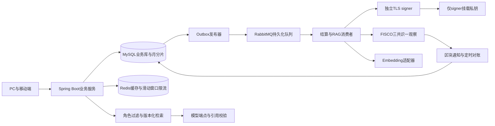
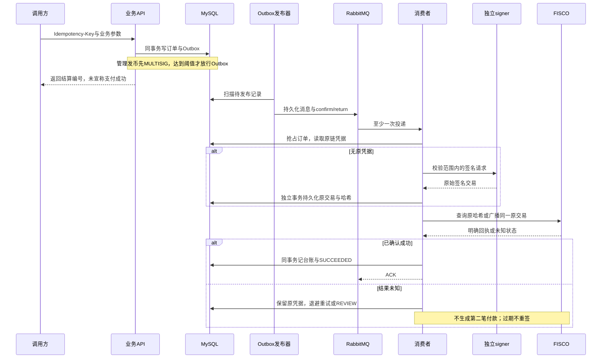

# 基于区块链的时间币服务系统

## Agent实施进展（2026-11-19）

用户已启动原规划中暂缓的三个Agent，开发分支`codex/agents`，实施顺序为活动发布编排→审核预筛→运营问答。下文“Agent暂不实施”的描述是此前交付范围，不能据此推断新Agent已经交付。

共用基础：`ActivityDraftValidator`拒绝模型设置身份、审核状态等受保护字段，严格校验名额/答谢整数和日期顺序，返回缺失字段而不猜测；`AiChatService.planAgentTool`复用模型配置与guardrail，要求单个严格JSON对象，模型未配置或输出异常时显式失败，不回退到模板冒充执行结果。Agent是受限工作流，不是可任意调用工具的自治系统。

**Agent-1已实现。** 用户已确认发布边界：Agent只生成草稿、收集字段补充并校验，由用户在移动端“发布活动”中的新面板明确确认表单及当前发布费。独立`PublishConfirmation`才调用原`UserService.oldAddActivity`与结算流程，未把该入口暴露给模型。用户确认属于原发布收费语义，不新增“AI签名”或绕过管理多签；每人答谢只是表单配置，不在这里支付。

`POST /users/old/agent/publish`携带`Idempotency-Key`创建任务，`GET /{id}`恢复，`PUT /{id}`携带revision与draft补充，`POST /{id}/confirm`携带revision、acceptedFee、confirmed=true确认。身份来自已验证token的请求上下文，不接收ownerId。任务持久化为NEEDS_INPUT→READY→SUBMITTED，草稿变化用乐观版本控制，确认加行锁并在同一事务保存结算结果及审计；重复确认复用原结算编号，时间过期/费用变化拒绝。模型调用在事务外，唯一业务键避免重复落库；已知任务可按编号恢复，尚无个人历史任务列表。步骤记录存`agent_audit`，不存token。建表脚本`schema-agent.sql`已加入MySQL/H2及分片初始化；关闭初始化的部署须先手动执行该脚本。

Agent-1集中验证：完整后端97项，78通过、19项外部集成跳过（`agent1-tests.log`）；追加真实H2结算事务及权限验证后定向44项全通过（`agent1-confirmation-tests.log`），包含重复确认只生成一条订单、越权、旧版本、未确认不发布、缺失字段和模型异常输出。移动端构建通过（`agent1-phone-build.log`），保留既有资源体积/Sass告警。远程模型只用本地HTTP替身，未声明真实模型效果或浏览器交互验收。Agent-2/3仍在实现中。

## 改进规划执行记录（更新至2026-11-18）

已同步目标仓库至`f79000f`，后续按A→B→C→D→E→F→G推进，每完成一大项后统一验证和更新现有文档。Agent部分保留规划中的“暂不实施”范围。规划中的工作量、兼容性和简历措辞需要以实际实现及验证为准。

- A项当前文件脱敏：安全报告移除姓名、学号；方案PDF移除封面团队编号、作者及XML元数据，并将第82～84页的6张人物照片替换为隐私说明。保留85页、原图注及参考文献，不删除公开文献作者信息。
- A项验证：PDF可重新打开，85页保持不变；未修改页面的提取文字与拉取版本完全一致；目标编号不再出现、作者/XML元数据为空、无附件、6张人物照片不再作为图片对象出现在对应页面；已渲染检查封面和照片页；`git diff --check`通过。仅修改文档，没有变更后端业务代码，因此本阶段不重复运行业务测试。
- 公开发布边界：历史提交仍包含脱敏前的PDF及安全报告，本次仅清理当前文件，未修改仓库可见性，也未重写远程历史。转公开前仍须单独处理历史记录并复核；不能仅凭当前文件脱敏就判定可公开。
- A、B项提交为`dec8efd`，C项提交为`148f21b`，D项提交为`8a59ab6`，E项为`8572809`，F项为`6f1efb0`。E至G在`codex/remaining-efg`分支交付；各项实际验收范围见下文。没有实现多数据库分片或Agent，不能将规划内容写成已交付功能。

## G项压测、架构与求职证据（2026-11-18）

### 可复现公告读取压测

场景文件为`performance/notices.jmx`，原始257414条采样压缩保存在`performance/results/notices-16.jtl.gz`，不包含token、请求正文或个人资料；全量统计为`notices-16-statistics.json`，缓存计数差值为`notices-16-cache.json`。原JTL的SHA256为`82e5dede5aed1350178a7b429482e13ba9031cb4774b4318922e63137c226eaf`。

环境：Windows11、Ryzen7 7800X3D（8核16线程），WSL2分配约15GiB；JMeter5.6.3明确使用Java11，同机通过`kubectl port-forward`访问K3S。后端1副本、CPU上限2核/内存1GiB，MySQL8.0、Redis7.2.16、RabbitMQ3.13，链和signer同时运行。数据仅1条合成公告，`GET /dashboard/notices?limit=10`，Keep-Alive、无思考时间；先4线程预热20秒，再16线程、5秒爬升、60秒测量，只有一次正式测量，不代表容量上限或稳定性测试。

| 指标 | 实测值与口径 |
|---|---|
| 样本数/错误数 | 257414/30，包含爬升和全部失败样本 |
| 吞吐 | 4296.97请求/秒，JMeter报告按首末样本时间跨度计算；60秒调度器摘要为4287.6请求/秒，二者计时边界不同 |
| 平均/P95/P99 | 3.48ms/7ms/11ms，统计窗口设置为1000000以覆盖全部样本，另以全量排序复核P95/P99 |
| 错误率 | 0.011654%，30次均为503，未剔除 |
| 公告首次查询命中率 | 257382/257414＝99.987569%；首次未命中32次，其中2次重建、30次锁竞争，Redis降级0次 |

这些数字仅适用于小数据公告缓存读取，不能外推为结算TPS、链吞吐、模型QPS或生产SLA。缓存重建时当前策略明确拒绝并发读，因此存在503；需要零错误率的业务应另行设计等待/陈旧值策略并验证一致性，不能直接删除失败样本。每次缓存读仍查数据库版本。无“优化前”对照组，不声称提升倍数。

复现时先在独立测试库用管理员公告接口加入一条合成公告。下载[Apache JMeter5.6.3](https://archive.apache.org/dist/jmeter/binaries/)并核对官方SHA512，再使用Java11绝对路径执行；Windows默认PATH中的Java23曾造成Groovy断言不兼容，该次失败预热不计入正式测量。HTTP200之外还断言业务`code=1`和非空公告列表，防止空数据或业务错误被当作成功。

```sh
/path/to/java11/bin/java -jar tools/apache-jmeter-5.6.3/bin/ApacheJMeter.jar -n \
  -t performance/notices.jmx -Jthreads=4 -Jduration=20 -Jramp=2 \
  -l backend/timecoin-web/target/warmup.jtl -j backend/timecoin-web/target/warmup.log
# 在无其他公告请求时，分别保存压测前后的管理员GET /administrator/notices/cache-metrics响应
/path/to/java11/bin/java -jar tools/apache-jmeter-5.6.3/bin/ApacheJMeter.jar -n \
  -t performance/notices.jmx -Jthreads=16 -Jduration=60 -Jramp=5 \
  '-Jjmeter.reportgenerator.statistic_window=1000000' \
  -l backend/timecoin-web/target/notices.jtl -j backend/timecoin-web/target/notices.log \
  -e -o backend/timecoin-web/target/notices-report
```

每次使用新的结果路径，不追加到旧JTL；PowerShell多行使用反引号或改成单行，带点的`-J`参数整体加引号。缓存计数是单进程LongAdder累计值，进程重启归零；停止请求后取前后差值，首次GET直接命中才计hits，二次检查命中仍归为首次miss。多副本需逐实例采集并汇总，不能通过负载均衡随机读一个实例。管理员指标接口有鉴权，没有清零入口。

G项集中验证：后端`package -Dp1.integration=true`共89项，79通过、10个外部专用测试跳过，日志`backend/timecoin-web/target/g-final-tests.log`；新增计数测试覆盖命中/重建、锁竞争和Redis断连降级，权限回归覆盖未登录、普通用户和管理员访问指标。JMeter场景真实运行并校验业务响应，原始失败样本与计数一致。本项未修改前端，不重复前端构建。

### 架构与结算时序



业务API、Outbox与消费者当前在同一Spring Boot应用，signer独立部署；没有把所有模块拆成微服务。RAG远程端点可配，实测使用离线模式与协议替身。Kubernetes部署清单与D项按月分表分别验证，当前K3S闭环未启用分片profile，不把两种测试配置混为一次联合验证。



### 可追问的设计说明

| 问题 | 当前实现与取舍 |
|---|---|
| 为什么不能只用分布式锁防重复付款？ | 锁只控制一段时间内谁执行，租约失效后仍可重做。幂等键按业务主体及操作限定，同键参数变化拒绝；订单、原交易凭据和台账提供跨重试结果复用。客户端须在同一次操作重试时沿用原键。 |
| Outbox为什么可靠？ | 业务变更与Outbox同事务避免“订单提交但消息未发”；confirm/return和轮询补偿处理投递不确定性。消息可能重复，消费者仍需幂等，不能称为端到端exactly-once。链成功但数据库未提交时按原哈希恢复。 |
| nonce为什么曾用数据库行锁？ | 以太坊递增nonce需要跨实例分配，本地synchronized不能协调多个进程；短事务行锁分配并先持久化。FISCO改为随机nonce，不沿用递增分配表，但仍需业务键互斥及同一原交易恢复。 |
| 版本缓存比延迟双删解决了什么？ | 公告修改与版本递增同事务，缓存键带版本，旧读回填不会覆盖新版本。每次读仍查数据库版本，允许短暂旧读；它不是数据库零访问，也不是强一致读。TTL抖动、短空值缓存和互斥重建分别处理集中到期、空结果和击穿。 |
| 分表为何选月份？ | 结算具备时间查询与保留周期，月份便于裁剪路由和预建表；非时间入口需目录定位，跨月恢复要找到原分片。当前是单MySQL按月分表，不是多数据库水平扩容，也没有实测亿级数据。 |
| 三共识一观察能容忍一个恶意节点吗？ | 不能。PBFT的3f+1只计共识节点，观察节点不投票；四共识才满足f=1。当前拓扑仅用于职责分离演示。 |
| signer与多签分别保护什么？ | signer把交易私钥隔离出业务进程，并校验链、群组、合约和selector；多签要求管理操作由不同审批人批准。signer不是HSM，主机管理员仍可读密钥，允许的转账操作仍需业务权限控制。 |
| RAG引用校验是否消除幻觉？ | 只验证引用来自检索证据且引文确实存在，不证明每句推论正确。角色过滤、版本复核、无命中拒答与线程池隔离降低越权、陈旧回答和模型拥塞风险；真实模型质量仍待单独评测。 |

### 简历表述候选

定位：Java后端研发，以异步结算可靠性为主线，RAG工程与联盟链治理作为补充。下列是仓库功能候选表述；使用者应能亲自解释实现与验证过程，不能把AI辅助开发直接描述为个人独立完成全部架构。

- 围绕时间币异步结算，实现业务幂等、事务Outbox、RabbitMQ确认与重复消费处理，链交易先持久化再广播，结合原哈希恢复和对账处理跨系统结果不确定性。
- 使用Redis实现Lua滑动窗口限流和版本化公告缓存；基于ShardingSphere-JDBC实现结算相关表按月分片，覆盖跨月定位与恢复测试。
- 实现知识库异步入库、分块Embedding、按角色过滤检索及引用校验，支持远程模型配置与离线验证；Agent仍属后续规划，未宣称真实模型效果达标。
- 接入FISCO联盟链、独立TLS signer和管理操作多签，提供Docker与Kubernetes（K3S发行版）部署清单，验证节点、中间件重建后的数据保留与真实结算闭环。

HR短开场白候选：您好，我希望应聘Java后端研发岗位。我的时间银行项目重点验证异步结算可靠性，包含Spring Boot、Redis、RabbitMQ、按月分表，以及独立签名和管理多签；已保留故障恢复测试与K3S部署证据，也实现了带引用校验的RAG流程，希望进一步交流。

面试自述可按“链上成功但数据库未知的实际问题→幂等与原交易恢复设计→消息重复/响应丢失测试→部署重启暴露的节点与权限缺陷→修复与边界”展开。仍需补强的证据是：本人独立复现和讲解、真实模型效果集、多机故障测试、带业务数据分布的结算负载；不填造生产用户量、吞吐提升比例或上线收益。

## F项容器与Kubernetes部署（2026-11-18）

`backend/Dockerfile`提供Java11非root镜像；`k8s/base`包含后端、MySQL、Redis、RabbitMQ及各自PVC/Service，凭据通过Secret注入。`k8s/fisco`叠加4个独立节点和TLS签名服务。业务进程不挂载operator私钥，signer仅允许backend访问8443且禁止出站；节点证书、SDK证书、签名私钥、服务端TLS与客户端信任库分别挂载。Secret本身不是HSM，应配合集群静态加密、RBAC和宿主机权限管理。

部署顺序（在仓库根目录使用Linux命令，镜像需导入K3S的containerd或推送到可访问的镜像仓库）：

```sh
mvn -f backend/pom.xml package
docker build -t timebank-backend:local -f backend/Dockerfile .
# 下载官方3.10.0 Linux二进制并解压到deploy/fisco/local/fisco-bcos
docker build -t timebank-fisco:3.10.0 deploy/fisco
kubectl apply -f k8s/base/namespace.yaml
# 将k8s/secrets.env.example复制到deploy/secrets/，填写各自随机密码和JWT密钥
kubectl -n timebank create secret generic timebank-secrets --from-env-file=deploy/secrets/k3s.env
kubectl apply -k k8s/base
# 先建立节点Service，取得P2P所需ClusterIP；节点此时等待配置Secret属预期状态
for i in 0 1 2 3; do kubectl -n timebank apply -k k8s/fisco/node$i; done
bash deploy/fisco/import-k8s.sh /absolute/generated/nodes/127.0.0.1 deploy/secrets/fisco-k8s timebank
```

节点配置由前述`bootstrap.sh`生成；运维部署及观察节点转换沿用E项`FiscoAdminMain`命令，SDK可通过回环port-forward连接。先部署合约，再填写`k8s/fisco/runtime.env.example`中的operator地址和合约地址，创建名为`fisco-runtime`的ConfigMap。独立生成operator私钥和审批人密钥，审批人密钥不放入集群。额外Secret约定：`signer-key`含`operator.key`；`signer-auth`含`token`；`signer-server-tls`含`server.p12`、`password`；`signer-client-trust`含`truststore.p12`、`password`。证书SAN至少包含`signer`和`signer.timebank.svc`，truststore只信任签发CA。凭据文件均放在已忽略的`deploy/secrets/`，不能提交到Git。完成后执行`kubectl apply -k k8s/fisco`，用`kubectl -n timebank port-forward --address=127.0.0.1 svc/backend 18080:8080`访问。

**版本与重启修复。** E项最初使用节点3.8.0；F项实际复现其重启后查询旧合约导致退出139，独立Windows SDK同样复现。3.8执行器查询路径引用未初始化的`m_blockContext`；上游[#4487](https://github.com/FISCO-BCOS/FISCO-BCOS/pull/4487)、[#4551](https://github.com/FISCO-BCOS/FISCO-BCOS/pull/4551)修复相关访问。现在固定节点二进制3.10.0，保留数据兼容版本3.8.0及Java SDK3.8.0，未启用新EVM特性。[官方3.10兼容说明](https://github.com/FISCO-BCOS/FISCO-BCOS/releases/tag/v3.10.0)支持旧数据逐节点替换二进制。先停观察节点备份数据，再逐节点重建验证，未重新部署合约或清空PVC。各节点StatefulSet使用`OnDelete`，运维必须一次仅删除一个节点Pod并核验恢复，不同时滚动四个节点。RabbitMQ启动时修正自身cookie为0600，解决kubelet的fsGroup卷权限处理导致重建后Erlang拒绝启动的问题；禁用后端及signer的Service环境变量注入，避免自动`SIGNER_PORT=tcp://...`覆盖应用整数端口。

**验收与边界。** 本地Docker内K3S v1.34.1+k3s1，单节点、单副本中间件、local-path卷，不代表高可用或跨主机容灾。后端、signer、链节点使用TCP探针，只证明端口接受连接，不保证依赖或共识可用；基础RAG默认local-hash/extractive，不声称调用真实大模型。K3S容器需稳定网络地址，WSL重启后的Docker地址重分配曾导致网络控制器启动失败，恢复原测试容器地址后恢复；正式部署应使用稳定节点网络。

实测原合约`0x6849f21d1e455e9f0712b1e99fa4fcd23758e8f1`重启查询回归通过。真实链路完成两名独立审批人签名→MULTISIG转READY→RabbitMQ消费→TLS signer签名→FISCO确认→MySQL入账，结算`818ac78f-1e90-477a-9c88-c7afe56272d1`为SUCCEEDED，1次尝试，余额5，哈希`0xc7a0007760df7d7179bb74954c606f563459ef6b12d653f2fb98c4c3a304325f`。Redis重建后测试键保留，RabbitMQ重建后4个durable队列保留；这不等于已验证队列中未消费消息的断电恢复。清单通过API服务器dry-run，两个部署脚本通过`bash -n`。

MySQL Pod重建后上述SUCCEEDED订单及原哈希保留。F项后端集中回归86项，76通过、10跳过（未开启分片/FISCO等外部专用开关），日志`backend/timecoin-web/target/f-final-tests.log`；另行开启的旧合约重启查询测试1项通过，日志`f-query-upgrade.log`。未将跳过项计为通过。

## E项联盟链、独立签名与管理多签（2026-11-17）

新增FISCO BCOS3.8.0非国密EVM适配，使用Java SDK3.8.0；上层转账、发币、余额查询和结算API保持兼容。以太坊分支仍用于旧凭据恢复和已有回归，Web3j的ABI编码也继续复用，不能表述为“彻底删除Web3j”。FISCO选择`fisco`配置，业务进程不加载operator私钥；证书用于节点TLS连接，与交易私钥分开。

**本地节点与职责。** `deploy/fisco/bootstrap.sh`调用官方固定版本脚本生成4节点，RPC为20250～20253、P2P为30350～30353，全部绑定回环地址。通过链治理委员会提案将node3转为观察节点，验证3个共识节点＋1个观察节点。观察节点不参与投票，不能把这一拓扑宣称为“容忍一个恶意共识节点”：PBFT的`3f+1`按共识节点计算；要演示`f=1`应使用4个共识节点。四进程同机也不代表跨主机高可用。K3S部署属于F项，不能用本地进程测试替代集群验证。

**交易可靠性。** `FiscoTransactionService`按业务键互斥，调用signer后验证签名载荷的链、群组、目标、参数、哈希与区块有效期，再以独立事务保存原交易，最后广播。FISCO使用SDK生成的随机nonce，不参与以太坊的递增nonce分配；`nonce_value`为NULL，随机nonce保存在原始签名交易中，历史以太坊nonce不修改。逻辑表和既有月表的可空迁移随初始化执行；禁用初始化的库必须在维护窗口预先迁移。

恢复先查询原哈希，已确认则直接复用；回执未知只允许有效期内重播同一签名，不能重新签名。FISCO3.8.0的未知哈希和部分存储错误都可能返回查询异常，因此异常不等于“未执行”。过期且无法核实回执时保留凭据并转人工核查；业务订单按既有重试次数进入`REVIEW`。明确的链上revert才将凭据标为`FAILED`。区块通知合并后在独立线程唤醒只读对账，5秒最多执行一轮；原定时对账继续补偿断线，通知不直接改余额。事件页从最新区块回扫，最多10000块，超限明确报错；它不是生产历史事件索引。

**独立signer。** 用户选定自建进程方案，不使用云KMS。`SignerMain`不启动Spring、不连接数据库、不广播交易，私钥仅从`SIGNER_KEY_FILE`读取；后端只持有调用token与预期签名地址。请求限定链、群组、合约和函数选择器，限制正文大小、线程数、队列与并发；没有任意摘要签名或部署入口。跨主机监听必须配置TLS，客户端使用JVM信任库并禁止重定向；回环地址允许HTTP供本机测试。独立进程减少业务代码直接读取私钥的范围，但不等同HSM：宿主机管理员仍可读取文件/内存，业务服务失陷仍可能滥用允许的转账函数。生产需独立系统账户、只读密钥挂载、网络隔离及调用审计；当前是本地工程验证。

| 进程 | 必填配置 |
|---|---|
| 后端`fisco`profile | `FISCO_CONFIG`、`FISCO_GROUP_ID`、`FISCO_CHAIN_ID`、`BLOCKCHAIN_CONTRACT_ADDRESS`、`SIGNER_ADDRESS`、`SIGNER_URL`、`SIGNER_TOKEN`，以及原数据库/JWT/Redis/MQ配置 |
| signer | `SIGNER_KEY_FILE`、`SIGNER_TOKEN`（至少32字节）、`SIGNER_CHAIN_ID`、`SIGNER_GROUP_ID`、`SIGNER_CONTRACT`、`SIGNER_SELECTORS=9b80b050,0a875551` |
| signer监听 | 默认`SIGNER_HOST=127.0.0.1`、`SIGNER_PORT=8443`；非回环须设置`SIGNER_TLS_KEYSTORE`（PKCS12）、`SIGNER_TLS_PASSWORD`；调用端配置可信CA |
| 运维部署 | `FISCO_DEPLOY_KEY_FILE`、`FISCO_CONFIG`、`FISCO_GROUP_ID`、`FISCO_CHAIN_ID`、`FISCO_CONTRACT_ARTIFACT`、`SIGNER_ADDRESS`、`GOVERNANCE_APPROVERS`（独立地址逗号分隔）、`GOVERNANCE_THRESHOLD`、`GOVERNANCE_DEPLOYMENT_ID`、`FISCO_DEPLOY_RECEIPT_FILE`（必须是新文件） |

SDK配置模板在`deploy/fisco/sdk.toml.example`。节点证书、signer私钥、审批人私钥和部署管理员私钥职责不同，不能把同一个文件挂载到所有进程。测试使用临时密钥及本地演示链；不要复用测试管理员账户。

```bash
# 在TimeCoinSystem执行npm ci及npx hardhat test后构建后端
mvn -f backend/pom.xml package
# 环境变量就绪后，独立启动signer；不要使用java -jar启动业务主类
java -Dloader.main=org.example.timecoinweb.signer.SignerMain -cp backend/timecoin-web/target/timecoin-web-0.0.1-SNAPSHOT.jar org.springframework.boot.loader.PropertiesLauncher
# 单独运维进程部署新合约，输出地址并保存部署前的原始凭据
java -Dloader.main=org.example.timecoinweb.signer.FiscoAdminMain -cp backend/timecoin-web/target/timecoin-web-0.0.1-SNAPSHOT.jar org.springframework.boot.loader.PropertiesLauncher deploy
# observer子命令另需FISCO_OBSERVER_NODEID_FILE；权限模式下通过委员提案执行
java -Dloader.main=org.example.timecoinweb.signer.FiscoAdminMain -cp backend/timecoin-web/target/timecoin-web-0.0.1-SNAPSHOT.jar org.springframework.boot.loader.PropertiesLauncher observer
java -jar backend/timecoin-web/target/timecoin-web-0.0.1-SNAPSHOT.jar --spring.profiles.active=fisco
```

**管理多签与冻结。** 新合约`GovernedTimeCoin`将operator和审批人分离，审批阈值至少2，审批人不得重复或等于operator。管理操作使用独立审批人的`personal_sign`签名；摘要绑定部署域、合约地址、提案ID、动作、账户、数值和期限。合约校验签名顺序、low-s、不同审批人、阈值、期限及提案防重放。发币数量限正数且不超过64位台账范围；冻结阻止该账户发币及双向转账，解冻也要多签。用户转账仍由后端operator代发，不声称用户持有链钱包或自行签交易。

管理员发币创建`MULTISIG`结算单与治理提案，不创建outbox；收齐有效签名后同一事务将订单改为`PENDING`并插入outbox，后续沿用可靠结算。冻结提案达到`READY`后由管理员执行，结果不明时恢复原提案。PC时间币页新增提案、冻结/解冻和提交签名入口；每个审批人应独立核对参数和摘要，页面不接收私钥。FISCO合约`block.timestamp`使用毫秒，以太坊使用秒，提案期限按后端协议计算并在真实链测试中核验。

管理API（均需管理员token）：`GET /administrator/chain/governance`；`POST /governance/freeze`提交`userId,frozen`及`Idempotency-Key`；`POST /governance/{id}/approve`提交`signature`；`POST /governance/{id}/execute`执行已审批冻结。后三者省略的前缀均为`/administrator/chain`。发币仍使用原`/mint`接口；审批签名可以由任一管理员转交，但必须来自合约认可的不同审批密钥，不能用管理员登录次数代替多签。

**升级治理。** 不实现计划中未经核实的“同地址覆盖部署”。[官方说明](https://github.com/FISCO-BCOS/FISCO-BCOS-DOC/blob/release-3/3.x/zh_CN/docs/key_concepts.md)指出重新部署产生新地址和独立存储。当前采用维护窗口流程：停止新写入→清点全部未决结算/原链凭据→导出并核验余额→部署新版本→记录版本、Git提交、ABI/字节码摘要、地址、部署哈希及审批记录→验证新链后切换配置。旧凭据必须在原链/原合约配置下恢复；不能直接切地址重试旧订单。新合约没有代理升级或自动余额迁移，旧余额不会自动出现。链部署权限应由独立治理委员管理，使用权限模式的部署白名单及版本审批；业务signer白名单不允许部署。链级委员会审批和业务合约多签是两套权限，不能相互替代。

**演示积分与隐私规则。** 本系统时间币用于封闭服务记账，不提供提现、法币兑换、投资收益或对外交易接口；这只是产品范围，不能据此宣称已取得金融或运营合规认定。链上记录业务userId、金额、交易与冻结事件，姓名、电话、地址等资料留在受控数据库；userId能关联数据库个人信息，属于可关联标识，不是不可复原的匿名化数据。[个人信息保护法官方文本](https://www.miit.gov.cn/jgsj/zfs/fl/art/2022/art_515a4b20c12f430eab54bb4f56d89f56.html)区分去标识化与匿名化。

本地演示只使用合成用户与资料；使用真实资料前需确定处理目的、必要字段、用户告知、授权范围、访问和删除渠道以及最短保存期限。链节点和备份均限制访问，数据库与节点快照分开管理，恢复后核查结算/台账/链余额。链上历史不能保证逐条删除，注销时应停止非必要处理并按实际要求处理链下映射、日志和备份；不得承诺“删除数据库即删除所有链上信息”。当前没有自动留存清理、协议版本同意记录、第三方合约审计、等保或备案，不用于真实运营背书。

验证命令：普通回归`mvn -f backend/pom.xml test`；本地真实链显式增加`-Dfisco.integration=true -Dtest.fisco-config=target/fisco-local/sdk.toml`。节点成员切换验证另传`test.fisco-observer-file`和`test.fisco-admin-keyfile`，仅对自己的回环测试链执行。测试部署独立合约并启动独立signer子进程，证书、临时密钥、原始日志均留在忽略的`target/`，不上传GitHub。

本大项集中验证结果：后端85项，83项通过、2项跳过（未启用外部RabbitMQ重启演练和MySQL专用EXPLAIN），覆盖真实Redis/RabbitMQ、MySQL分片以及FISCO；`package`成功，日志`backend/timecoin-web/target/e-final-tests.log`。合约6项通过，日志`e-contract-tests.log`；PC构建通过，日志`e-pc-build.log`（保留原有体积告警）。新增测试覆盖签名策略、不同审批人/重复签名、MULTISIG到outbox原子放行、冻结、重放/跨合约攻击、过期交易禁止重签、错误回执及链上revert。真实链测试在独立signer子进程中签名，模拟节点执行后响应丢失，重试后仅2条凭据（1次发币＋1次转账）、收款余额9；测试合约`0x0662b023d9f87a06cecb053702e9c77510f1056f`，转账哈希`0x6eed4cbae2996db11bc013a0addc19fa57fe2ca57ed6dadff7fa0c53f24f65c3`。这是本地功能证据，不是性能或生产可用性指标。

## D项按月分表实施与验证（2026-11-16）

本轮使用ShardingSphere-JDBC5.3.2、Spring Boot2.6.13和Java11，保留默认非分片模式，通过`sharding`profile显式启用。实际验证发现Boot默认SnakeYAML1.29缺少`setCodePointLimit`，已固定为ShardingSphere所用的1.33；Maven优先中央仓库，OSGeo仍供原地理依赖使用。

相对规划的必要调整：outbox和chain_submission原来没有创建时间，UUID也不能推出月份，所以无法“业务代码零改动”。已补齐时间列与路由目录，改造受理、查询、重试、消费、回执恢复及入账SQL。当前只有一个物理数据源`ds`，三个金融业务表按月拆表，共享原数据库本地事务；没有启用多数据源、XA或跨库余额双写。`user/activity`按广播规则配置，但单数据源下仍各只有一份，不代表已验证多库广播一致性。

- 分片表：`settlement_order_yyyyMM`、`settlement_outbox_yyyyMM`、`chain_submission_yyyyMM`；使用`created_at`与内置`INTERVAL`算法，默认预留`202601`～`202612`，不改UUID。结算与outbox显式写入同一秒级时间，配置binding group，关联查询增加创建时间相等条件，避免跨月份错误组合。
- `shard_locator`是非分片的全局目录，以类型＋查询键为主键，保存UUID、幂等请求键或交易哈希对应的原创建时间；目录与实体在同一事务提交，失败一并回滚。目录也为相同类型的请求键提供跨月唯一约束。查询原结算/回执使用目录得到的时间路由，不用当前月份猜测；客户端传原UUID即可。
- 列表、活动关联核验、outbox扫描、兼容历史请求键查找及nonce最大值查询，显式限定在全部已配置月份范围；仍会扫描该范围内多个分片，未实现用户传入月份过滤、历史归档或消除列表逐条加载。签名账户仍使用非分片`chain_signer`行锁，nonce根据保留范围内的最大值分配；未声称链吞吐提升。
- 范围采用`SHARDING_START`包含、`SHARDING_END`不包含的月份，最多120个月。新写入超出范围直接拒绝；启动时验证物理表存在，并拒绝目录中存在配置范围外的历史记录。所有实例的JVM、JDBC连接与数据库会话须使用一致时区，例如Asia/Shanghai；INTERVAL本身不代替时区治理。
- 旧非分片库升级时给outbox补创建时间并从对应结算回填；旧链凭据没有可靠创建时间，新增列保留NULL，不把部署时间伪装为交易历史。非分片业务继续可用；启用分片时如果逻辑模板表仍有记录，会拒绝启动，避免静默隐藏已付款记录。

启用步骤（使用新建的独立MySQL库，不直接指向已有业务库）：

1. 设置`SHARDING_JDBC_URL`、`DB_USERNAME`、`DB_PASSWORD`和原有`JWT_SECRET`等配置，JDBC URL指定正确时区；启动profile为`sharding`，本地中间件端口仍通过`REDIS_PORT/RABBITMQ_PORT`提供。
2. 首次设置`SHARDING_INITIALIZE=true`：先运行原有MySQL结构初始化与迁移，再创建目录，并按`SHARDING_START=2026-01`、`SHARDING_END=2027-01`为三个表预建12个月物理表。只克隆空逻辑模板的结构，不复制历史行。数据库本身须提前创建。
3. 建表后改回`SHARDING_INITIALIZE=false`运行；每次启动都会校验模板表为空、目录范围和目标物理表存在。扩大月份范围时，先用初始化模式预建新表再统一更新全部实例配置，保留旧月份。后续字段/索引升级必须覆盖已有物理表，`CREATE TABLE ... LIKE`不会迁移已经存在的分片结构。
4. 默认`dev`及原中间件测试继续使用非分片数据源；不要把`dev`和`sharding`混用。链、模型和MQ开关沿用原配置，分片profile不会自动开启真实链或提供模型密钥。

分片键取舍：按月有利于时间段查询、预建与后续归档，但当前月份形成写热点；ID取模更利于均匀写入，却不利于按时间归档，时间查询也更容易散到多个分片。UUID不含月份，目录查询是保持旧API与跨月幂等所需的额外成本。单库分表不突破单MySQL实例的资源上限，目录和签名锁仍是集中访问点；本项未作容量或性能达标声明。

历史迁移与双写流程是操作设计，**没有实现自动双写迁移工具**：先备份并冻结金融写入，核对所有已签名和待确认交易；为缺失时间的历史凭据建立可审计的映射，再按原时间复制记录，保持UUID、幂等键、原交易字节、哈希、nonce和入账标记不变，同时构建目录。逐月核对行数、金额汇总、请求键唯一性、order/outbox配对和链凭据，切换前处理差异。若将来采用不停写迁移，应先在原事务写迁移outbox，以幂等消费者增量复制、追平并双读比对，短暂冻结最终切换；不能直接让请求线程分别写两库后声称一致。切换后回滚需先反向追平增量，不能简单切回旧profile。当前程序拒绝带数据的逻辑模板；离线迁移完成后应将原表保留在只读备份中，并在新库保留空模板，禁止为绕过检查直接删除原业务数据。

本项统一验证使用独立MySQL8.0.46、Redis7和RabbitMQ3.13：完整回归73项通过、2项条件测试跳过（外部broker重启和MySQL专用EXPLAIN），见`backend/timecoin-web/target/d-final-tests.log`。6项分片专项覆盖1月/2月真实物理表、跨月同键返回原单、绑定表查询、目录与业务回滚、旧月消费只入账一次、跨月复用签名与nonce递增、越界月份拒绝及启动拒绝遗漏历史/未迁移数据。补充真实RabbitMQ跨月派发后6项再次通过，见`d-sharding-mq-tests.log`；旧非分片MySQL升级联调10项通过、1项重启演练跳过，见`d-mysql-upgrade-tests.log`。链RPC仍为测试替身，不代表实链或多库XA验证。

复现：先在独立MySQL3307创建`timebank_sharding_test`，启动原独立Redis6380/RabbitMQ5673；测试使用已有本地测试账户配置。执行`mvn -o -f backend/pom.xml test '-Dp1.integration=true' '-Dsharding.integration=true'`；仅运行分片专项可再加`'-Dtest=ShardingIntegrationTests' '-Dsurefire.failIfNoSpecifiedTests=false'`。不传`sharding.integration=true`时跳过分片专项，常规测试仍不分片。测试会清理专用库的月表和专用MQ队列，勿指向业务环境。

最终执行`mvn -o -f backend/pom.xml package '-Dp1.integration=true' '-Dsharding.integration=true'`成功，73项通过、2项条件测试跳过，生成可执行后端JAR；证据为`d-package-tests.log`。本项没有前端改动，不重复前端构建。

配置依据：[ShardingSphere5.3.2分片规则](https://shardingsphere.apache.org/document/5.3.2/en/user-manual/shardingsphere-jdbc/java-api/rules/sharding/)、[INTERVAL算法参数](https://shardingsphere.apache.org/document/5.3.2/en/user-manual/common-config/builtin-algorithm/sharding/)。日志及构建产物保留在target，不新增开发说明文档。

## C项高并发设计补强（2026-11-16）

限流从固定窗口改为精确滑动日志：Redis ZSET保存已放行请求，Lua使用Redis服务端`TIME`计算毫秒时间，原子删除`时间戳≤当前时间−60000ms`的记录、检查额度并写入UUID成员。登录/注册仍按来源IP合并10次，其他已鉴权写请求按用户合并30次，统计区间为最近60秒；UUID避免同毫秒请求合并。满额返回429，`Retry-After`按最早记录距出窗的剩余时间向上取整，拒绝请求不写记录也不续期；Redis故障返回503，异步再分派不重复扣额度，非正额度配置启动失败。

新键使用`timebank:rate:v2:`，避免旧String计数器与新ZSET冲突，旧键按原TTL自然到期。升级时额度会重新起算；新旧实例混跑期间各用一套额度，应统一切换版本，不能宣称滚动升级窗口内仍有统一总额度。单个身份的集合最多保存配置额度数量，但活跃身份数量仍会影响Redis总内存。实现参考[Redis服务端时间](https://redis.io/docs/latest/commands/time/)和[按分值清理ZSET](https://redis.io/docs/latest/commands/zremrangebyscore/)。

MySQL核验发现旧库缺少源码已声明的`ix_settlement_owner`和`ix_settlement_activity`：`CREATE TABLE IF NOT EXISTS`只保证表存在，不迁移旧表索引。新增`schema-query-indexes-mysql.sql`按索引名称检查并补齐，另增加`settlement_order(created_at)`、`activity(status,update_time)`、`activity(old_id,update_time)`；H2使用对应幂等脚本。两者均接入初始化链路。已有同名但定义不同的索引不自动重建；生产大表建索引需预先评估DDL时间与锁影响，不应直接套用本地测试耗时。

EXPLAIN实测环境为MySQL8.0.46独立`timebank_p1_test`库，事务内加入1000条结算、1000条outbox和1000条活动，结束回滚。结算10%为PENDING、90%为SUCCEEDED，100个owner均分；活动5种状态均分，全部属于同一老人，时间字段相同。以下`rows`是优化器估计扫描量，不是实际耗时或QPS；该样本不能代表生产分布。

| 实际查询 | 修改前 | 索引迁移后 |
|---|---|---|
| 结算outbox轮询，含PENDING/RETRY和过期PROCESSING，按next_send排序取10条 | s表`range/ix_settlement_due/rows=102`，o表`eq_ref/PRIMARY/rows=1`；临时表＋filesort | 相同，保留跨表过滤与排序成本，未强制改变驱动表 |
| 活动status=2，按update_time倒序取10条 | `ALL/rows=1000`，where＋filesort | `ref/ix_activity_status_updated/rows=200`，Backward index scan，无filesort |
| 指定老人活动，按update_time倒序取10条 | `ALL/rows=1000`，where＋filesort | 仍为`ALL/rows=1000`；新复合索引是候选，但该老人拥有全部样本，优化器未选择它 |
| owner_id=1的结算，按created_at倒序取100条 | `ALL/rows=1000`，where＋filesort | `ref/ix_settlement_owner/rows=10`，Backward index scan＋Using index |
| 管理员全部结算，按created_at倒序取100条 | `ALL/rows=1000`，filesort | `index/ix_settlement_created/rows=100`，Backward index scan＋Using index |

完整SQL及计划由`MiddlewareIntegrationTests.recordMysqlCoreQueryPlansWithRollbackFixtures`输出`C_EXPLAIN`记录。原始证据在`backend/timecoin-web/target/c-mysql-tests.log`，迁移后在`c-mysql-indexed-tests.log`；不新增说明文档。活动标题/地址的`LIKE '%关键词%'`不因这些B-tree索引变成高效全文检索；本项未改造搜索，也未消除结算列表逐条加载的查询次数。

分布式锁与业务幂等的区别：锁解决某一时间段谁可以执行，例如RAG缓存重建互斥；租约过期或进程崩溃后，另一实例仍可能重做。幂等解决同一业务重复提交后结果是否重复生效：本项目通过请求键唯一约束、参数摘要比对、持久状态和业务事务复用原结算单；链上重试复用原签名交易，消费者通过租约令牌阻止过期任务提交。仅有Redis锁不足以保证不重复付款，outbox的至少一次投递也必须配合消费幂等。缓存版本号负责隔离更新前后的缓存条目，不能代替幂等或金融账务事务。

本大项统一验证：后端＋真实Redis/RabbitMQ执行67项通过、2项跳过（外部broker重启演练和MySQL专用EXPLAIN）；日志`c-final-tests.log`。独立MySQL联调启用EXPLAIN，10项通过、1项重启演练跳过；日志`c-mysql-indexed-tests.log`。真实Redis测试覆盖双实例20次并发仅放行10次、窗口滑动、拒绝不续期、动态等待时间和旧键兼容；原权限、RAG、结算回归同时通过。本项无前端改动，不重复前端构建。

另单独复跑EXPLAIN测试验证启动后再次执行索引迁移，1项通过，日志`c-migration-repeat-test.log`；SQL核查活动与结算样本均已回滚至0条。`git diff --check`通过。

复现普通回归：`mvn -o -f backend/pom.xml test '-Dp1.integration=true'`。MySQL回归在同一命令增加`'-Dtest=MiddlewareIntegrationTests' '-Dsurefire.failIfNoSpecifiedTests=false' '-Dc.explain=true'`，并按独立测试库设置`test.datasource-url`、`test.datasource-driver=com.mysql.cj.jdbc.Driver`、`test.datasource-user`和`test.datasource-password`，同时指定`'-Dtest.schema=classpath:schema-mysql.sql' '-Dtest.index-schema=classpath:schema-query-indexes-mysql.sql'`。EXPLAIN测试仅允许库名以`_test`结尾，需使用独立Redis/RabbitMQ，勿指向业务库。

## B项RAG实施与验证（2026-11-16）

管理员在PC端“知识库管理”粘贴已核实的文档、FAQ或公告正文，设置标题与可见角色，提交后刷新查看状态。当前支持纯文本/Markdown正文，不支持PDF解析或URL抓取；公告按导入时的正文快照保存，修改公告后需禁用旧资料并重新导入。老人端和志愿者端沿用原AI问答入口，新增来源标题、片段编号与原文摘录。

- 可靠入库：文档与outbox同事务写入；相同幂等键与参数复用文档，参数变化返回409。独立持久化队列`timebank.rag.work`使用confirm/return确认，outbox重投未完成任务。消费者以180秒租约和随机令牌抢占，网络调用在事务外；全部向量完成后，文档、片段及知识库版本同事务提交。禁用或租约失效后旧消费者不能复活资料；失败退避重试，5次后转`REVIEW`，管理员可重试。
- 检索：按600个Unicode码点切分，重叠80码点，Embedding每批最多16段。向量持久化到数据库，`VectorIndex`的内存实现按版本重建快照，先过滤角色，再做全量余弦Top-5检索。正文最多16000个UTF-16代码单元，最多500份未禁用文档，适用于小规模知识库；未实现ANN、pgvector或Milvus适配。支持全部登录用户、老人、志愿者、管理员四种可见范围，不提供个人私有知识库。
- 生成与引用：检索证据进入Prompt，模型须返回严格JSON；引用编号须来自本次检索，引文须是原文连续片段，否则拒绝输出。保留输入/输出guardrail，无命中不调用生成模型。返回前复核知识库版本，更新或禁用期间返回409重试。引用校验仅证明来源存在，不能证明回答中每句话正确。
- 线程隔离：所有AI接口使用`DeferredResult`，独立4个工作线程、16个排队位置，满载返回503；120秒超时返回504并取消任务、移除排队项。模型HTTP总时限80秒，Embedding单次25秒。异步再分派不重复消耗写请求限流额度。
- 缓存：Redis键包含知识库版本、角色、问题摘要、Embedding/问答配置、模式和阈值。成功结果缓存120～150秒，无命中缓存10秒，同键互斥租约150秒并校验令牌释放；锁忙返回503。启用Redis但连接失败时拒绝生成，防止模型请求激增。不同环境须使用独立Redis实例。

默认生产配置使用远程Embedding和模型生成，已移除停用域名默认值。`dev`明确使用`local-hash`词面向量与`extractive`原文摘录，页面标注非大模型生成，不在远程失败时自动降级。

| 环境变量 | 用途 |
|---|---|
| `AI_RAG_EMBEDDING_MODE` | `remote`或`local-hash` |
| `AI_RAG_EMBEDDING_URL`、`AI_RAG_EMBEDDING_KEY` | OpenAI兼容Embedding完整端点与密钥 |
| `AI_RAG_EMBEDDING_MODEL`、`AI_RAG_EMBEDDING_DIMENSIONS` | 模型名与维度，默认`text-embedding-v3`、512；须与供应商支持一致 |
| `AI_RAG_ANSWER_MODE` | `model`生成＋引用，或`extractive`离线摘录 |
| `AI_CHAT_BASE_URL`、`AI_CHAT_API_URL` | 基础地址＋路径，后者也可填写完整URL |
| `AI_CHAT_API_KEY`、`AI_CHAT_MODEL` | 问答密钥与实际开通的模型名 |
| `AI_RAG_MQ_ENABLED` | 默认跟随`settlement.mq-enabled`；关闭时导入保持`PENDING`，不会同步索引 |
| `AI_RAG_MINIMUM_SCORE` | 默认0.2，上线前需针对知识库和模型评估 |

完整本地演示：按下文启动已有`backend/compose.p1.yml`，后端使用`dev,p1`、`REDIS_PORT=6380`和`RABBITMQ_PORT=5673`，JWT配置沿用现有方式。管理员导入资料并等到`READY`后，用可见角色提问。真实模型验证需显式覆盖上述两种模式并提供模型配置；Embedding配置变化后旧向量不参与检索，须禁用旧文档并重新导入。

管理API：`GET/POST /administrator/knowledge`（POST需`Idempotency-Key`）、`DELETE /administrator/knowledge/{id}`禁用、`POST /administrator/knowledge/{id}/retry`重试，沿用JWT管理员鉴权。问答仍使用`POST /users/old/ai/chat`和`POST /users/vol/ai/chat`，请求`{"message":"问题"}`；成功响应`data`保留`reply`并新增`mode/citations`。开放式聊天已改为知识库回答，尚未入库会提示依据不足；资料类型只是管理员填写的分类，不代表自动同步公告。

本项完成后统一验证，日志位于`backend/timecoin-web/target/`，不纳入Git：

| 检查 | 实际结果 |
|---|---|
| 后端＋真实Redis/RabbitMQ | `mvn -o -f backend/pom.xml test '-Dp1.integration=true'`：66项通过，1项需外部broker重启的旧演练跳过；`b-final-tests.log` |
| MySQL8＋真实Redis/RabbitMQ | 独立测试库执行`MiddlewareIntegrationTests`：8项通过，同一重启演练跳过；`b-mysql-tests.log`。首次测试连接缺少认证配置，修正测试JDBC参数后通过，未修改生产认证 |
| 新增验证 | Unicode切分、幂等、重复消费、租约恢复、禁用竞争、失败重试、角色隔离、版本失效、伪造引用拒绝、guardrail、Embedding协议、队列饱和/超时取消、异步鉴权/限流、真实MQ入库和Redis短缓存/互斥 |
| PC端与手机端 | 分别`npm run build`通过；`b-pc-build.log`、`b-phone-build.log`。原有Sass弃用与资源体积告警保留，未做浏览器交互验收 |
| 原请求幂等回归 | `node --experimental-vm-modules --test vue-system/tests/settlement.test.cjs`：6项通过；`b-request-tests.log` |

Embedding远程协议使用本地HTTP测试服务，生成模型使用测试替身；未调用真实云模型，没有Qwen效果或QPS达标声明。Agent仍暂不实施。下方P1章节保留当时的历史测试数量与范围，当前RAG进展以本节为准。

仓库发布配置：默认MySQL密码通过`DB_PASSWORD`环境变量注入，不在代码中保存；`dev`测试配置不受影响。发布快照排除构建目录、本地链部署产物、IDE配置和压缩包。

已移除未启用OSS工具类中的历史密钥注释；当前图片上传仍使用本地存储。未来接入OSS需通过环境变量提供凭据，历史暴露的密钥应在阿里云控制台撤销或轮换。

## P1实施与验证（2026-11-16）

P0的32项回归复跑通过，具备进入P1的条件。本轮范围为Redis缓存/限流与RabbitMQ可靠结算，不包含分库分表、RAG/Agent、K8s或性能达标声明。

- 第一阶段：35项后端测试通过，覆盖原P0场景，以及普通转账请求幂等、发布扣费超时恢复、消费者租约恢复和重试上限。原同步答谢测试已改为“受理→消费→检查最终状态”，链RPC仍由Mockito模拟。
- `settlement_order`与`settlement_outbox`在一个数据库事务提交。发布活动先保存为状态`0=待扣费`，成功扣费后与台账一起转为`1=待审核`；状态0不能审批、报名、编辑或删除。待结算答谢不能撤回或取消报名；关联答谢结算后冻结活动编辑和删除，避免已签名金额失去依据。
- 发布、用户转账、管理员转账/增发必须携带`Idempotency-Key`（8～100位字母、数字、冒号、下划线或横线）。同一用户、操作和编号复用原结算，参数变化拒绝；答谢使用活动＋志愿者作为业务唯一编号。客户端超时后必须保留原编号。
- 成功响应只代表受理，返回`settlementId/state/activityId`。状态为`PENDING/PROCESSING/RETRY/SUCCEEDED/REVIEW`；仅`SUCCEEDED`代表链回执、台账和业务状态完成。本人通过`GET /info/settlements`或`/{id}`查询；管理员通过`GET /administrator/chain/settlements`查看，核查后用`POST /administrator/chain/settlements/{id}/retry`恢复原结算。达到8次尝试转人工核查，不自动新建交易。
- RabbitMQ持久化队列、消息、publisher confirm＋mandatory return检查；消费方法在数据库状态提交后返回并ACK。outbox会重投未完成订单，重复消费靠数据库租约与业务幂等消除重复入账；RPC等待不持有业务行锁。默认单活消费者、prefetch=1，削峰而非宣称链上高吞吐。签名账户nonce由数据库行锁分配，链配置变化不能偷偷重建原结算。
- 公告缓存使用Redis JSON、空结果短TTL、TTL抖动、重建互斥锁，以及随公告事务提交的数据库版本号；旧版本缓存自然过期，读旧数据不能覆盖新版本。公告允许短暂旧读，Redis不可用时读数据库；余额、报名名额和权限决策不使用缓存。
- 登录/注册按来源IP合并限流，已鉴权写请求按用户限流，Lua一次完成计数与过期。默认分别10次/分钟、30次/分钟；超限429，Redis故障503，均含`Retry-After`。不信任客户端伪造的转发IP头，代理部署需配置可信真实IP边界。
- 默认配置启用Redis与MQ；`dev`关闭二者及链，`dev,p1`启用中间件。连接环境变量为`REDIS_HOST/PORT/PASSWORD`及`RABBITMQ_HOST/PORT/USER/PASSWORD`。新增表随已有SQL初始化加载，升级前备份数据库；结算、outbox、链凭据必须一起保留。
- 第二阶段：40项测试通过（0失败、0错误、0跳过）。其中5项使用独立真实Redis/RabbitMQ，验证重复消息只入账一次、无路由消息退回后outbox保留、无效消息进入死信队列、两个限流实例共享计数与过期时间、公告版本隔离与空结果缓存。数据库为H2，链确认仍为模拟，不代表实链联调。
- PC和移动端生产构建通过。新增结算记录、管理员恢复原结算、待扣费活动展示；发布与币操作在浏览器持久保存未确认请求编号，网络失败后复用原编号且不存密码。页面成功提示改为“已受理”，仅结算状态标记最终完成。
- 最终验证：48项后端测试通过，0失败、0错误、0跳过（39项业务/权限/链回执测试、2项限流故障策略测试、7项真实中间件测试）。补充了outbox写入失败回滚、20个请求并发受理只有一单、两个独立签名服务分配不同nonce、待结算活动不可修改、接口受理不等待RPC等场景。实际重启RabbitMQ后，已确认持久化消息无需outbox重发仍完成消费与入账。仅发布费结算完成、无人报名且仍待审核/被拒绝的活动，继续允许老人按原规则删除，结算审计记录保留。
- 在独立MySQL8.0＋Redis7＋RabbitMQ3.13上复跑6项中间件/并发受理测试通过；该轮跳过需外部协调的broker重启测试，重启场景已在上述完整48项运行中实测通过。链RPC及链确认仍使用模拟，未执行真实Geth联调、应用JVM强杀恢复、链重组验证或性能压测；不能将这些正确性测试写成TPS指标。
- 前端6项请求幂等测试通过，验证超时后刷新页面仍复用原编号、未确认请求不能改参数、明确受理后可开始下一笔独立操作。PC与移动端最终生产构建通过；原有Sass弃用和资源体积等告警仍保留。
- 独立开发中间件配置见`backend/compose.p1.yml`：`docker compose -f backend/compose.p1.yml up`，Redis端口6380、RabbitMQ端口5673，仅绑定回环地址。开发启动后端需设置`REDIS_PORT=6380`、`RABBITMQ_PORT=5673`并启用`dev,p1`；付费业务另外显式开启链及其原有配置。WSL环境需保持前台会话，避免发行版闲置关闭导致容器退出；测试专用队列会清理，不要指向生产broker。
- 升级需前后端同时发布：旧客户端不携带请求编号将收到400；旧“请求成功即支付完成”的语义不再适用。P0历史普通转账/mint凭据不会自动回填结算单，升级前先核查未入账记录；已明确失败的链回执不会通过重试生成新付款，业务撤销/重新授权仍需人工处置。分库分表、RAG/Agent、微服务拆分和K8s属于后续阶段。

复现与证据（从项目根目录执行，PowerShell的`-D`参数建议整体加单引号）：

| 检查 | 命令/证据 |
|---|---|
| 无外部服务回归 | `mvn -f backend/pom.xml test`：41项执行，7项中间件测试跳过 |
| 常规中间件回归 | `mvn -f backend/pom.xml test '-Dp1.integration=true'`：47项执行，1项外部重启演练跳过 |
| 完整重启演练 | 再加`'-Dp1.broker-restart=true'`；看到`P1_BROKER_RESTART_READY`后45秒内在另一终端执行`docker compose -f backend/compose.p1.yml restart rabbitmq`；48项全部执行 |
| 浏览器请求幂等 | `node --experimental-vm-modules --test vue-system/tests/settlement.test.cjs`：6项通过 |
| 本轮日志 | `backend/timecoin-web/target/p1-final-test.log`、`p1-mysql-test.log`、`p1-browser-request-test.log`、`p1-pc-build.log`、`p1-phone-build.log`（构建目录，不纳入Git） |

MySQL复跑使用独立测试库`timebank_p1_test`。在已运行的测试MySQL上设置下列参数；测试会清理其业务测试数据，不得连接现有业务库：

```powershell
mvn -f backend/pom.xml test '-Dp1.integration=true' '-Dtest=MiddlewareIntegrationTests' '-Dsurefire.failIfNoSpecifiedTests=false' '-Dtest.datasource-url=jdbc:mysql://localhost:3307/timebank_p1_test?allowPublicKeyRetrieval=true' '-Dtest.datasource-driver=com.mysql.cj.jdbc.Driver' '-Dtest.datasource-user=root' "-Dtest.datasource-password=$env:P1_MYSQL_PASSWORD" '-Dtest.schema=classpath:schema-mysql.sql'
```

设计依据：[Spring AMQP确认与退回](https://docs.spring.io/spring-amqp/docs/2.4.12/reference/html/)、[Redis原子限流](https://redis.io/docs/latest/commands/incr/)。下文P0段落是上一阶段记录；异步结算与幂等行为以本节为准。

## P0修复与回归记录（2026-11-16）

本节记录代码实际实现与测试结果；方案中的Redis、MQ、微服务、RAG、Agent和性能目标不代表已完成能力。

- 报名与取消：后端校验活动状态和截止时间；事务中统一先锁活动，再操作报名记录。取消仅在实际删除报名记录后返还一个名额，重复取消不改变名额；名额异常时整笔取消回滚。
- 第一轮验证：8项Spring Boot＋H2内存库集成测试通过，覆盖重复取消、未报名取消、截止与状态校验、20个请求竞争5个名额、并发重复报名/取消、异常回滚。这是正确性回归，不是MySQL性能压测。
- 第二轮验证：累计19项测试通过，新增管理员注册边界、登录身份与数据库角色一致性、统计接口鉴权、密码字段不出参、活动归属、编辑字段限制、结束时间校验、签到不触发支付、已支付不可撤回等回归。
- 第三轮验证：累计24项测试通过。新增签名交易先持久化再广播、成功回执后入账、回执失败不完成服务、超时后恢复原答谢、台账失败整体回滚后安全重试、重复回执不重复入账和金额越界校验。链RPC使用Mockito模拟；未据此宣称已通过真实Geth/MySQL联调。
- 最终验证：32项后端测试全部通过（0失败、0错误、0跳过）。增加RPC断连、nonce分配、恢复接口鉴权、关键词路径绕过、JWT篡改、20个并发完成请求仅支付一次、完成状态写入失败后台账回滚、定时状态刷新前的过期活动拦截。答谢采用“短事务校验→事务外等待回执→短事务提交台账和完成状态”，网络等待不占用业务数据库连接。
- PC和移动端生产构建通过。构建仍有Sass弃用、样式和资源体积告警；本轮未处理这些无关问题。PC公开注册入口改为账号说明，已答谢服务隐藏撤回入口，401响应清除登录状态。单笔链写入请求默认等待90秒，可用`VUE_APP_CHAIN_REQUEST_TIMEOUT_MS`调整；批量请求等待180秒，超时后需刷新核对处理结果。
- 本轮仅新增交易凭据实现类和SQL初始化文件；回归测试扩展已有测试类，说明集中更新README、交易规则、Dashboard接口文档与原安全报告，未新建说明文档。真实MySQL/Geth联调、云端部署与压测尚未执行。
- 新增`schema-chain-submission.sql`随MySQL/H2初始化加载，保存PREPARED/SUBMITTED/CONFIRMED/FAILED及入账标记。备份数据库时必须保留该表；已有库只增表，不清空业务数据。仅活动答谢具备稳定业务编号幂等；普通转账和mint发生超时后不能另建请求重试。
- 管理员可通过`GET /administrator/chain/transactions`查看近期凭据，再用`POST /administrator/chain/transactions/{txHash}/resume`确认或重发原签名交易。该接口只恢复链上确认，不冒充业务入账完成；答谢恢复后回原活动确认完成，其他交易由管理员核对台账。
- 默认余额对账改为只读报告，避免自动覆盖并发入账。手工修正须暂停交易，并先核查未入账凭据；不能先把余额改成链上新余额，再重复应用该笔增减。当前为单应用实例同步确认，尚未实现MQ、后台自动恢复、链重组处理及多实例签名调度。
- 发布扣费当前配置为4个时间币（dev关闭链时跳过）。发布页面已延长回执等待并阻止处理中重复点击，但发布扣费与活动创建仍是跨系统的两步操作，尚未纳入完整结算单/请求幂等；超时后应先核查活动和扣费记录。该失败窗口与普通转账请求幂等将在P1可靠消息与结算流程中继续完善。
- 权限规则：公开注册仅允许老人/志愿者；管理员通过已有管理员的用户管理页面创建。统计接口仅管理员可访问；公告和图片仍允许匿名读取。老人仅能编辑/删除自己无人报名的待审核或已拒绝活动；完成确认必须在活动结束后进行，已答谢服务不可直接撤回。
- JWT密钥改为环境变量`JWT_SECRET`，至少32字节；未配置则启动失败。首次运行可在PowerShell用`$env:JWT_SECRET=[Convert]::ToBase64String([System.Security.Cryptography.RandomNumberGenerator]::GetBytes(32))`生成当前终端密钥（PowerShell 7），部署时保存到Secret并在重启时复用；修改密钥后已有登录令牌失效。
- 回归命令：在项目根目录执行`mvn -f backend/pom.xml test`；测试自行使用独立内存数据库，不读写本地业务数据库。结果见`backend/timecoin-web/target/surefire-reports/`。

## 一、项目结构（你需要开几个终端）

| 角色 | 目录 | 说明 |
|------|------|------|
| **后端 API** | `backend/timecoin-web` | Spring Boot，默认端口 **8080** |
| **PC 管理端** | `vue-system/pc` | 浏览器访问，默认端口 **7000** |
| **移动端 H5** | `vue-system/phone` | 手机浏览器访问，端口以终端为准（常见 **7001**） |

**建议顺序：** 先启动后端 → 再启动 PC 或手机端（可同时开）。

---

## 二、环境要求

| 组件 | 说明 |
|------|------|
| **JDK** | 11（与 `backend` 中 Maven 配置一致） |
| **Node.js** | 16+ / 18+（用于前端与 Hardhat） |
| **MySQL** | 默认配置使用MySQL；本地无MySQL时显式启用`dev`，使用H2文件库 |

项目内已附带 Maven：`tools/apache-maven-3.9.6/`（Windows 用 `mvn.cmd`；Linux / macOS 可改用 `./tools/apache-maven-3.9.6/bin/mvn`）。

---

## 三、启动后端（必须先做）

当前默认配置为MySQL＋启用区块链。纯本地开发可显式启用`dev`，使用H2文件库并关闭链连接；此模式不执行付费答谢。启动前必须设置`JWT_SECRET`，见顶部P0记录。首次构建请从根目录执行`mvn -f backend/pom.xml install -DskipTests`，安装本项目模块依赖。

在 **PowerShell** 中执行：

```powershell
cd backend\timecoin-web
..\..\tools\apache-maven-3.9.6\bin\mvn.cmd spring-boot:run '-Dspring-boot.run.profiles=dev'
```

成功标志：日志中出现 `Tomcat started on port(s): 8080` 与 `Started TimecoinWebApplication`。  
停止：在该终端按 `Ctrl+C`。

API 根地址：**http://localhost:8080**

---

## 四、启动 PC 端（管理端）

**新开一个终端**，执行：

```powershell
cd vue-system\pc
npm install
npm run serve
```

- 浏览器打开终端里提示的地址，一般为：**http://localhost:7000**
- 前端请求后端的地址在 `vue-system/pc/src/utils/request.js` 中配置，默认 **http://localhost:8080**

**说明：** PC端用于管理员登录与后台管理；公开管理员注册已关闭，由现有管理员在用户管理中创建账号。老人、志愿者请在移动端注册。

---

## 五、启动移动端（老人 / 志愿者 H5）

**再开一个终端**，执行：

```powershell
cd vue-system\phone
npm install
npm run serve
```

- 本机浏览器访问：以终端输出为准，常见为 **http://localhost:7001/**
- 手机与电脑在同一 Wi‑Fi 时，用手机浏览器访问：**http://你的电脑局域网IP:端口/**（端口与终端一致）

**重要：** 移动端 `vue-system/phone/src/utils/request.js` 里 `baseURL` 默认为 `http://localhost:8080`。  
在**真机**上访问时，`localhost` 指向手机自己，会导致无法连后端。请改为电脑的局域网 IP，例如：

```javascript
baseURL: 'http://192.168.1.100:8080'  // 换成你电脑的实际 IP
```

改完后保存并重新执行 `npm run serve`。

---

## 六、使用 MySQL（本机已安装 MySQL 时）

**核心原则：** 不启用`dev`时使用MySQL；命令行或环境变量显式启用`dev`时使用H2。

1. **启动 MySQL 服务**（Windows 可在「服务」里确认 MySQL 正在运行）。

2. **初始化库表（二选一）**

   - **推荐：** 未使用`dev`时，启动自动执行`schema-mysql.sql`和`schema-chain-submission.sql`。配置数据库用户名、密码、`JWT_SECRET`以及启用链时所需的RPC和私钥后启动；首次初始化含演示管理员`admin/123456`，对外使用前必须修改口令。

   - **手动：** 当前完整结构以`backend/timecoin-web/src/main/resources/schema-mysql.sql`和`schema-chain-submission.sql`为准。`backend/schema-timecoin.sql`是历史脚本，不能替代当前初始化文件。

3. **改后端配置**  
   编辑 `backend/timecoin-web/src/main/resources/application.properties`：

   - 如曾启用以下配置或对应启动参数，请关闭它，以免继续使用H2：

     ```properties
     # spring.profiles.active=dev
     ```

   - 按你本机修改 **用户名、密码**（连接 URL 若与仓库默认一致可不改，已含时区等参数）：

     ```properties
     spring.datasource.username=root
     spring.datasource.password=你的MySQL密码
     ```

4. **启动后端**

   ```powershell
   cd backend\timecoin-web
   ..\..\tools\apache-maven-3.9.6\bin\mvn.cmd spring-boot:run
   ```

   若仍报 `Access denied`，说明用户名或密码与 MySQL 不一致，请改 `application.properties` 后再启动。

5. **切回H2开发**（可选）：启动时传入`-Dspring-boot.run.profiles=dev`。

---

## 七、区块链合约（可选）

`dev`模式可以不启动链，但付费答谢、转账和发币必须连接真实节点并配置合约；使用默认启用链的配置时，在项目根目录：

```powershell
cd TimeCoinSystem
npm install
npx hardhat node
```

另开终端部署到本地节点：

```powershell
cd TimeCoinSystem
npx hardhat deploy --network localhost
```

测试网部署需在 `TimeCoinSystem` 下配置 `.env`（参考 `TimeCoinSystem/.env.example`）。

---

## 八、登录与角色说明

| 端 | 角色 | 说明 |
|----|------|------|
| **PC** | 管理员 | 管理员登录与后台操作；账号由现有管理员创建 |
| **移动端 H5** | 老人、志愿者 | 注册时选择类型；登录使用账号密码（与注册身份一致） |

初始化脚本仍含演示管理员`admin/123456`，仅供本地初始化；对外部署前必须修改默认口令。后续管理员账号通过受保护的用户管理接口创建。

---

## 九、常见问题

### 端口 8080 已被占用

```powershell
netstat -ano | findstr :8080
taskkill /PID <上一步最后一列的PID> /F
```

若修改后端端口，需同步修改各前端 `request.js` 中的 `baseURL`。

### 注册/登录提示「操作失败」或数据库连接错误

- 使用**dev（H2）**时，确认启动参数显式启用`dev`。
- 使用 **MySQL** 时，确认账号密码、库名与 `schema-timecoin.sql` 已导入。

### 移动端能打开页面但接口失败

检查 `vue-system/phone/src/utils/request.js` 的 `baseURL`：真机必须用**电脑局域网 IP + 8080**，不能用 `localhost`。

---

## 十、目录说明

| 目录 | 说明 |
|------|------|
| `backend/` | Spring Boot + MyBatis 后端 |
| `vue-system/pc/` | PC 端 Vue 管理前端 |
| `vue-system/phone/` | 移动端 Vue H5（老人/志愿者） |
| `TimeCoinSystem/` | Hardhat + Solidity 合约 |
| `tools/apache-maven-3.9.6/` | 捆绑的 Maven |
