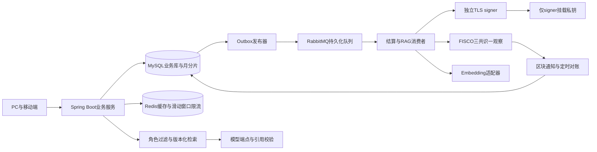
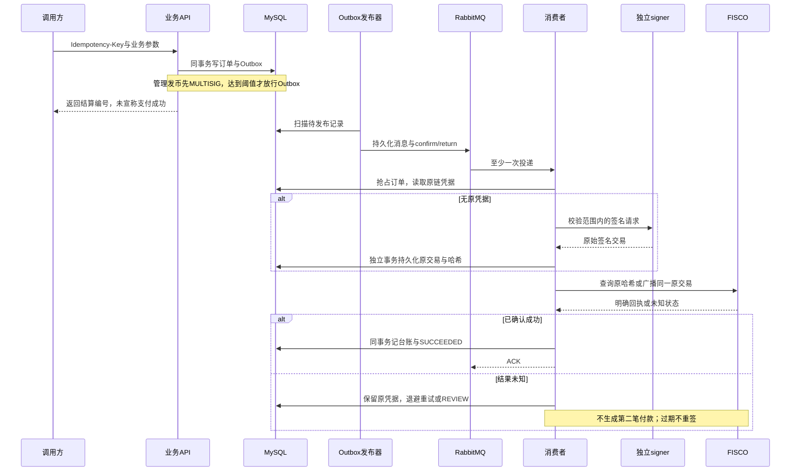

# 基于区块链的时间币服务系统

Java 后端项目，主线是**异步结算可靠性**：以 Outbox + 幂等 + 独立签名 + 链上对账处理跨系统结果不确定性；在此之上实现 **RAG 知识库问答 + 三个受限业务 Agent**、**按月分表**与**业务级联盟链治理**。

**技术栈**：JDK 21、Spring Boot 4.0.9、Spring Framework 7.0.10、MyBatis 4.0.0、ShardingSphere-JDBC 5.5.2、AgentScope Java 2.0.5、OkHttp 5.3.2、Redis、RabbitMQ、MySQL 8、Vue 2、Hardhat / Solidity、FISCO BCOS 3.8。

---

## 一、项目结构

| 目录 | 说明 |
|------|------|
| `backend/timecoin-web` | Spring Boot 后端 API，默认端口 **8080** |
| `vue-system/pc` | PC 管理端，默认端口 **7000** |
| `vue-system/phone` | 移动端 H5（老人 / 志愿者），默认端口 **7001** |
| `TimeCoinSystem/` | Hardhat + Solidity 合约 |
| `k8s/base`、`k8s/fisco` | K3S 部署清单（业务 + 中间件 / 联盟链节点与 signer） |
| `performance/` | 压测脚本与结果 |
| `tools/apache-maven-3.9.6/` | 捆绑 Maven |

启动顺序：先后端，再启动 PC 或移动端（可同时开）。

---

## 二、环境要求

| 组件 | 说明 |
|------|------|
| JDK | **21**（enforcer 限制 `[21,22)`） |
| Node.js | 16+ / 18+（前端与 Hardhat） |
| MySQL | 默认使用 MySQL；本地无 MySQL 时可启用 `dev` profile 使用 H2 文件库并关闭链 |
| Maven | 项目自带 `tools/apache-maven-3.9.6/` |

---

## 三、快速启动

### 1. 后端（必须先做）

启动前**必须设置 `JWT_SECRET`**（至少 32 字节，可用 `[Convert]::ToBase64String([RandomNumberGenerator]::GetBytes(32))` 生成）；未配置则启动失败。首次构建从根目录安装本项目模块依赖：

```powershell
mvn -f backend/pom.xml install -DskipTests
```

本地快速体验（H2 文件库、关闭链与 MQ）：

```powershell
cd backend\timecoin-web
..\..\tools\apache-maven-3.9.6\bin\mvn.cmd spring-boot:run '-Dspring-boot.run.profiles=dev'
```

使用 MySQL + 中间件（默认配置）：确保 MySQL 运行、设置 `DB_PASSWORD` 后直接 `mvn spring-boot:run`；首次启动自动执行 `schema-*.sql` 初始化，含演示管理员 `admin/123456`。

成功标志：日志出现 `Tomcat started on port(s): 8080` 与 `Started TimecoinWebApplication`。API 根地址：**http://localhost:8080**。

### 2. PC 管理端

```powershell
cd vue-system\pc
npm install
npm run serve
```

浏览器打开 **http://localhost:7000**；请求后端地址在 `src/utils/request.js`，默认 `http://localhost:8080`。

### 3. 移动端（老人 / 志愿者 H5）

```powershell
cd vue-system\phone
npm install
npm run serve
```

本机访问终端提示地址（常见 **http://localhost:7001/**）。真机访问需把 `src/utils/request.js` 的 `baseURL` 从 `localhost` 改为电脑局域网 IP（如 `http://192.168.1.100:8080`）。

### 4. 区块链合约（可选）

`dev` 模式可不启动链；付费答谢、转账、发币需连接真实节点。默认链配置指向本机 Hardhat：

```powershell
cd TimeCoinSystem
npm install
npx hardhat node
```

部署前按 `TimeCoinSystem/.env.example` 填写四个发行额度、operator、部署域和独立审批地址。默认部署 `GovernedTimeCoin`。另开终端：

```powershell
cd TimeCoinSystem
npx hardhat deploy --network localhost
```

部署后把 `blockchain.contract-address` 更新为新地址。FISCO 联盟链方式见 `deploy/fisco/` 与 `k8s/fisco/`。

---

## 四、登录与角色

| 端 | 角色 | 说明 |
|----|------|------|
| PC | 管理员 | 登录后操作后台；演示账号 `admin/123456`，新账号由管理员创建 |
| 移动端 H5 | 老人、志愿者 | 注册时选择类型，账号密码登录 |

登录接口为根路径 `POST /login`，body 含 `username/password/role`（管理员 `role=3`）；**token 放在 `token` 请求头**，不是 `Authorization`。

---

## 五、关键配置

配置集中在 `backend/timecoin-web/src/main/resources/application.properties`，敏感值走环境变量：

| 环境变量 | 用途 |
|----------|------|
| `JWT_SECRET` | JWT 签名密钥，至少 32 字节，必填 |
| `DB_PASSWORD` | MySQL 密码 |
| `REDIS_HOST/PORT/PASSWORD`、`RABBITMQ_HOST/PORT/USER/PASSWORD` | 中间件连接 |
| `BLOCKCHAIN_ENABLED`、`BLOCKCHAIN_RPC_URL`、`BLOCKCHAIN_CONTRACT_ADDRESS`、`BLOCKCHAIN_PRIVATE_KEY` | 链开关与连接 |
| `BLOCKCHAIN_MAX_SUPPLY` | 总发行硬上限，试点建议 20000000 |
| `BLOCKCHAIN_LIFETIME_MINT_THRESHOLD` | 单账户累计铸币人工复核阈值，试点建议 100000 |
| `BLOCKCHAIN_GLOBAL_DAILY_MINT_LIMIT`、`BLOCKCHAIN_ACCOUNT_DAILY_MINT_LIMIT` | 全局/单账户每日硬上限，试点建议 100000 / 1440 |
| `BLOCKCHAIN_GOVERNANCE_ENABLED` | 多签治理开关 |
| `AI_CHAT_ENABLED/BASE_URL/API_URL/API_KEY/MODEL` | 大模型端点（OpenAI 兼容，须支持原生 tool_calls） |
| `AI_RAG_EMBEDDING_MODE/URL/KEY/MODEL/DIMENSIONS`、`AI_RAG_ANSWER_MODE` | RAG：`remote`/`local-hash` 与 `model`/`extractive` |
| `AI_RAG_MQ_ENABLED` | 关闭时文档导入走同步处理 |

Agent 预算：`agent.react.max-iterations=6`、`max-tool-calls=12`、`timeout-seconds=90`。

---

## 六、系统架构

业务 API、Outbox 与消费者在同一 Spring Boot 应用内，signer 独立部署。



### 结算时序



### 时间币发行规则

1 币 = 1 分钟服务时长，单次答谢上限 999。四个发行参数（总发行上限、累计复核阈值、全局每日上限、账户每日上限）在合约部署时固定，不可运行时修改。链上 `totalSupply/lifetimeMinted/globalDailyMinted/accountDailyMinted` 计数器 mint 原子检查额度，转账不增加发行量。

总量与每日额度不可经多签豁免；跨累计阈值须在 PC 增发页申请复核（动作 `MINT_LIFETIME_REVIEW`），审批签名绑定该动作与不可变发行政策。日窗口按北京时间自然日计算：Ethereum 为 `(timestamp+28800)/86400`，FISCO 先除以 1000 归一化毫秒。服务端 `mint_quota_admission` 与结算单同事务登记，按链域加锁约束全局/账户当日受理金额；幂等重试不重复扣额。

### AI 能力

- **RAG**：文档与 Outbox 同事务入库 → RabbitMQ 异步切分(600 码点)/Embedding → 按角色过滤 + 版本化内存向量 Top-5 → 引用溯源（引文须来自本次检索且为原文连续片段，否则拒答）。异步任务 180s 租约抢占，失败 5 次转 `REVIEW`。
- **三个受限 Agent**（AgentScope `ReActAgent` 循环，原生 `tool_calls`）：

| Agent | 工具与行为 |
|-------|-----------|
| 发布 | `validate_draft` 返回字段问题供模型修订；`complete` 返回已校验草稿，发布与扣费仍走用户确认接口 |
| 审核 | `inspect_activity` 只查当前批次选中活动；固定规则风险不能被模型降级；结果待人工审批 |
| 运营 | `activity_registration_top` / `coin_daily_flow` 执行固定参数化 SQL，模型不能提交 SQL 或编造指标 |

模型只做只读工具选择，写操作在循环外由人工确认触发。仅「活动发布」这类低风险操作在 `agent.auto-confirm.enabled` 开启且草稿通过确定性校验后可自动执行；发币/结算/审核驳回等高风险操作始终须人工或多签。`agent_audit` 只记摘要哈希，不存思维过程/原文/密钥。

### 测试与评测

- 后端 **221 项单测**通过（`mvn test` 产出 jacoco 报告），行覆盖率 60.2%、分支覆盖率 50.3%；核心 AI/RAG 模块覆盖率高（agent 97%、rag 85%、interceptor 86%）。前端 phone 23 + pc 15 共 **38 项 Vitest 单测**（含 `.vue` 组件测试）。
- RAG 评测集 24 条标注（16 可回答 / 8 无依据）；Agent 有 36 条 `deepseek-chat` 真实模型 live 基线（`performance/results/real-model-baseline-live.json`），加入越权护栏后越权拒绝率从 0% 升至 83%。

### 关键设计取舍

| 问题 | 当前实现 |
|------|---------|
| 为什么不能只用分布式锁防重复付款？ | 锁只控制一段时间内谁执行，租约失效后仍可重做。幂等键按业务主体限定、同键参数变化拒绝。 |
| Outbox 为什么可靠？ | 业务变更与 Outbox 同事务；confirm/return + 轮询补偿。消息可能重复，消费者仍需幂等（at-least-once）。 |
| nonce 为什么用数据库行锁？ | 以太坊递增 nonce 需跨实例分配；短事务行锁分配并先持久化。FISCO 用随机 nonce。 |
| 版本缓存解决了什么？ | 公告修改与版本递增同事务，缓存键带版本，旧读回填不覆盖新版本；TTL 抖动、空值缓存、互斥重建分别处理。 |
| 分表为何选月份？ | 结算有时间查询与保留周期，便于裁剪路由与预建表。单 MySQL 按月分表，非多库水平扩容。 |
| 三共识一观察能容忍恶意节点吗？ | 不能，PBFT 的 `3f+1` 只计共识节点，四共识才满足 f=1。当前拓扑用于职责分离演示。 |
| signer 与多签分别保护什么？ | signer 把交易私钥隔离出业务进程并校验链/群组/合约/selector；多签要求管理操作由不同审批人批准。 |
| RAG 引用校验消除幻觉吗？ | 只验证引用来自检索证据且引文存在，不证明每句推论正确。 |

---

## 七、主要 API

| 分类 | 接口 | 说明 |
|------|------|------|
| 认证 | `POST /login` | 登录，token 走 `token` 头 |
| 知识库 | `GET/POST /administrator/knowledge`、`DELETE /{id}`、`POST /{id}/retry` | 导入(需 Idempotency-Key)、禁用、重试 |
| RAG 问答 | `POST /users/old/ai/chat`、`/users/vol/ai/chat` | body `{"message":"问题"}` |
| Agent-发布 | `POST /users/old/agent/publish`、`GET /{id}`、`POST /{id}/confirm` | 草稿校验 → 收集 → 用户确认 |
| Agent-审核 | `GET /administrator/agent/reviews/candidates`、`POST /administrator/agent/reviews`、`POST /{id}/decision` | 批量预筛 → 人工决定 |
| Agent-运营 | `POST /administrator/agent/analytics` | body `{"question":"..."}` |
| 链管理 | `GET /administrator/chain/status\|balance\|settlements\|transactions\|governance`、`POST /chain/mint\|transfer\|settlements/{id}/retry\|transactions/{txHash}/resume` | 均需管理员 token |

所有写请求携带 `Idempotency-Key`（8–100 位字母/数字/`:`/`_`/`-`）；客户端超时必须复用原键。

---

## 八、性能数据

`GET /dashboard/notices?limit=10` 小数据公告缓存读取压测（16 并发、60 秒、keep-alive，Java 21 / Boot 4.0.9 本机）：

| 指标 | 实测值 |
|------|--------|
| 样本数 / 错误数 | 294913 / 30 |
| 吞吐 | 4914.91 请求/秒 |
| 平均 / P95 / P99 | 3.23ms / 6.05ms / 8.24ms |
| 错误率 | 0.010172%（30 次均为 503 缓存重建锁忙） |
| 首次查询缓存命中率 | 99.9888% |

压测脚本 `performance/bench-notices.py`，原始采样 `performance/results/`。

---

## 九、常见问题

**端口 8080 被占用**

```powershell
netstat -ano | findstr :8080
taskkill /PID <PID> /F
```

修改后端端口需同步改各前端 `request.js` 的 `baseURL`。

**注册/登录失败或数据库连接错误**：`dev` 需确认显式启用 profile；MySQL 需确认账号密码与库表初始化。

**移动端能开页面但接口失败**：真机 `baseURL` 必须用电脑局域网 IP + 8080，不能用 `localhost`。

**提示"限流服务暂不可用" / MQ 连接失败**：检查 Redis(6379) 与 RabbitMQ(5672) 是否运行；限流为 fail-closed，Redis 不可用会直接拒绝请求。

**链上交易未确认、余额不变**：先核验连接的链域、合约地址、原交易哈希和 nonce。重建 Hardhat 链不等同普通重启，应保留原交易凭据并按迁移流程核对原链。
